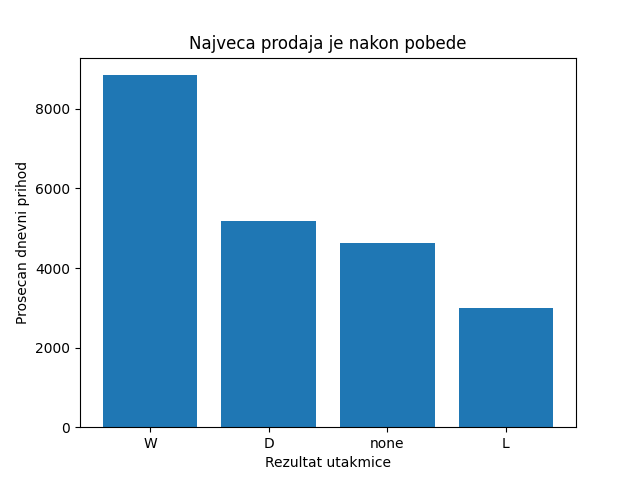

# ETL Projekat - Da li pobede prodaju dresove?

## Projekat - opis
Svrha projekta jeste provera da li rezultati fudbalskih utakmica utiču na prodaju navijačkih dresova.
Pipeline preuzima, čisti i obrađuje podatke o porudžbinama, proizvodima i fudbalskim utakmicama.

## Rezultati
- Ukupno porudžbina: 1852
- Ispravnih porudžbina: 1800
- Odbijenih porudžbina: 52
- Ukupan prihod: 10.045.400 RSD

## Analiza rezultata

Analiza pokazuje da je prosečan dnevni prihod najveći nakon pobede, a najmanji nakon poraza.

## Grafički prikaz rezultata

## Struktura projekta

- pipeline.ipynb - kodovi pipeline
- data/raw - preuzeti podaci
- data/processed - obrađeni podaci, rezultati analize, grafikon i log fajl
- README.md - opis projekta

